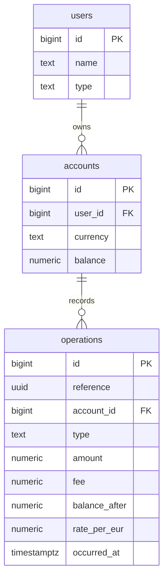

# Features

What the Account Deposits service does, in terms of its API and data. How to run it is described in [DEPLOYMENT.md](DEPLOYMENT.md). The business rules themselves are in [Task.md](Task.md).

All examples below were taken from a real run against a freshly seeded database. Run them in the order shown, starting from a freshly seeded database, because the withdrawal, the transfer and the history build on the operations before them. A new run returns other `reference`, `occurredAt` and `traceId` values; everything else is the same.

## 1. Database schema



### `users`

| Column | Type     | Constraints                            | Description     |
| ------ | -------- | -------------------------------------- | --------------- |
| `id`   | `bigint` | Primary key                            | Set by the seed |
| `name` | `text`   | Not null                               | Display name    |
| `type` | `text`   | Not null, `CHECK` `Basic` or `Premium` | The user's tier |

### `accounts`

| Column     | Type            | Constraints                                                                            | Description          |
| ---------- | --------------- | -------------------------------------------------------------------------------------- | -------------------- |
| `id`       | `bigint`        | Primary key                                                                            | Set by the seed      |
| `user_id`  | `bigint`        | Not null, foreign key to `users.id`, `ON DELETE RESTRICT`, index `ix_accounts_user_id` | The owner            |
| `currency` | `text`          | Not null, `CHECK` `EUR`, `USD` or `GBP`                                                | The account currency |
| `balance`  | `numeric(18,2)` | Not null, default `0`, `CHECK balance >= 0`                                            | The current balance  |

### `operations`

Every completed operation, one row per affected account. A transfer is two rows that share a `reference`: `TransferOut` on the sender's account and `TransferIn` on the receiver's. Rows are only ever added, never changed. Refused operations are never written.

| Column          | Type            | Constraints                                                                              | Description                                                                                |
| --------------- | --------------- | ---------------------------------------------------------------------------------------- | ------------------------------------------------------------------------------------------ |
| `id`            | `bigint`        | Primary key, identity                                                                    | Keeps operations at the same moment in the order they were recorded                        |
| `reference`     | `uuid`          | Not null, unique together with `account_id` (index `ix_operations_reference_account_id`) | The operation reference shown to the user                                                  |
| `account_id`    | `bigint`        | Not null, foreign key to `accounts.id`, `ON DELETE RESTRICT`                             | The account the row belongs to                                                             |
| `type`          | `text`          | Not null, `CHECK` `Deposit`, `Withdrawal`, `TransferOut` or `TransferIn`                 | The kind of operation                                                                      |
| `amount`        | `numeric(18,2)` | Not null, `CHECK amount > 0`                                                             | The amount in the account currency, without the fee. For `TransferIn`, the amount received |
| `fee`           | `numeric(18,2)` | Not null, `CHECK fee >= 0`                                                               | The fee in the account currency; always 0 for `TransferIn`                                 |
| `balance_after` | `numeric(18,2)` | Not null, `CHECK balance_after >= 0`                                                     | The account balance after the operation                                                    |
| `rate_per_eur`  | `numeric(18,6)` | Not null, `CHECK rate_per_eur > 0`                                                       | Units of the account currency per 1 EUR at the time of the operation; 1 for EUR accounts   |
| `occurred_at`   | `timestamptz`   | Not null                                                                                 | When the operation happened, in UTC                                                        |

Index `ix_operations_account_id_occurred_at_id` on `(account_id, occurred_at, id)` serves the history and the weekly allowance.

## 2. Seed data

| User id | Name             | Type    |
| ------- | ---------------- | ------- |
| 1       | Basic User       | Basic   |
| 2       | Premium User     | Premium |
| 3       | Low Balance User | Basic   |

| Account id | User id | Currency | Starting balance |
| ---------- | ------- | -------- | ---------------- |
| 101        | 1       | EUR      | 100,000.00       |
| 102        | 1       | USD      | 100,000.00       |
| 103        | 1       | GBP      | 100,000.00       |
| 201        | 2       | EUR      | 100,000.00       |
| 202        | 2       | USD      | 100,000.00       |
| 203        | 2       | GBP      | 100,000.00       |
| 301        | 3       | EUR      | 100.00           |

Users 1 and 2 hold all three currencies, so every transfer example in Task.md section 4.4 can be reproduced between them. Account 301 reproduces the rejection examples in section 4.5.

## 3. Endpoints

| Method | Path                                               | Purpose                                                            |
| ------ | -------------------------------------------------- | ------------------------------------------------------------------ |
| `GET`  | `/users/{userId}/accounts`                         | Every account of the user, with its balance                        |
| `POST` | `/users/{userId}/accounts/{accountId}/deposits`    | Deposit into one of the user's accounts                            |
| `POST` | `/users/{userId}/accounts/{accountId}/withdrawals` | Withdraw from one of the user's accounts                           |
| `POST` | `/users/{userId}/accounts/{accountId}/transfers`   | Transfer from one of the user's accounts to another user's account |
| `GET`  | `/users/{userId}/operations`                       | Every operation on the user's accounts, newest first               |

The service has no authentication. `userId` in the path names the acting user, and every operation checks that the account belongs to that user. The examples pipe the response through `jq` only to format it; without `jq`, drop `| jq` and the response is the same. Request bodies are JSON (`Content-Type: application/json`). Money is a JSON number with at most two decimals. Currencies and operation types are strings.

### 3.1 `GET /users/{userId}/accounts`

Every account of the user, ordered by id.

**Request:** no body. `userId` is a whole number.

**Response:** an array of:

| Field      | Type    | Description           |
| ---------- | ------- | --------------------- |
| `id`       | integer | Account id            |
| `currency` | string  | `EUR`, `USD` or `GBP` |
| `balance`  | number  | Current balance       |

**Errors:**

| Status | Code                | When                           |
| ------ | ------------------- | ------------------------------ |
| 400    | `VALIDATION_FAILED` | `userId` is not a whole number |
| 404    | `USER_NOT_FOUND`    | The user does not exist        |

**Example:**

```bash
curl -s http://localhost:5080/users/1/accounts | jq
```

```json
[
  { "id": 101, "currency": "EUR", "balance": 100000.0 },
  { "id": 102, "currency": "USD", "balance": 100000.0 },
  { "id": 103, "currency": "GBP", "balance": 100000.0 }
]
```

### 3.2 `POST /users/{userId}/accounts/{accountId}/deposits`

Adds `amount` to the account and charges the deposit fee from the same account: 0.05% of the amount, at most 3.00 EUR (converted). The fee is rounded up to the cent, so for a very small deposit it can equal the amount: a 0.01 EUR deposit pays a 0.01 EUR fee, the balance stays the same, and the deposit is still recorded.

**Request:**

| Field    | Type   | Required | Format                                                                            |
| -------- | ------ | -------- | --------------------------------------------------------------------------------- |
| `amount` | number | Yes      | Positive, at most two decimals, at most 1,000,000,000.00, in the account currency |

**Response:**

| Field          | Type          | Description                                                   |
| -------------- | ------------- | ------------------------------------------------------------- |
| `reference`    | string (uuid) | The operation reference                                       |
| `fee`          | number        | The fee charged                                               |
| `currency`     | string        | The currency of the fee and the balance: the account currency |
| `balanceAfter` | number        | The balance after the operation                               |

**Errors:**

| Status | Code                     | When                                                                                            |
| ------ | ------------------------ | ----------------------------------------------------------------------------------------------- |
| 400    | `VALIDATION_FAILED`      | The body is missing or not valid JSON, or a value has the wrong type                            |
| 400    | `INVALID_AMOUNT`         | `amount` is missing (it counts as 0), zero, negative, finer than 0.01 or above 1,000,000,000.00 |
| 404    | `ACCOUNT_NOT_FOUND`      | The account does not exist or belongs to another user                                           |
| 415    | `UNSUPPORTED_MEDIA_TYPE` | The body is not sent as `application/json`                                                      |
| 503    | `RATES_UNAVAILABLE`      | The account is not in EUR and no usable exchange rates are loaded                               |

**Example:**

```bash
curl -s -X POST http://localhost:5080/users/1/accounts/101/deposits \
  -H 'Content-Type: application/json' -d '{"amount":1000.00}' | jq
```

```json
{
  "reference": "01a1c5f3-3720-7819-bfd3-9b36f0f54f9c",
  "fee": 0.5,
  "currency": "EUR",
  "balanceAfter": 100999.5
}
```

### 3.3 `POST /users/{userId}/accounts/{accountId}/withdrawals`

Takes `amount` plus the fee from the account. A basic user pays 0.5% of the amount, at least 1.00 EUR (converted). A premium user pays 0.25% of the part above the weekly free allowance; see section 3.6.

**Request:** the same as a deposit:

| Field    | Type   | Required | Format                                                                            |
| -------- | ------ | -------- | --------------------------------------------------------------------------------- |
| `amount` | number | Yes      | Positive, at most two decimals, at most 1,000,000,000.00, in the account currency |

**Response:** the same fields as a deposit: `reference`, `fee`, `currency` and `balanceAfter`.

**Errors:** every error of a deposit, and:

| Status | Code                 | When                                           |
| ------ | -------------------- | ---------------------------------------------- |
| 422    | `INSUFFICIENT_FUNDS` | `amount` plus the fee is more than the balance |

**Example:**

```bash
curl -s -X POST http://localhost:5080/users/1/accounts/101/withdrawals \
  -H 'Content-Type: application/json' -d '{"amount":100.00}' | jq
```

```json
{
  "reference": "01a1c5f3-37eb-7705-b1ef-38dd09a1051e",
  "fee": 1.0,
  "currency": "EUR",
  "balanceAfter": 100898.5
}
```

This continues from the deposit example: 100,999.50 − 100.00 − 1.00 (the basic minimum).

### 3.4 `POST /users/{userId}/accounts/{accountId}/transfers`

Sends money from one of the user's accounts to an account of another user. The sender pays the same fee as for a withdrawal and is debited `amount` plus the fee. The receiver pays nothing and is credited the amount converted via EUR into the receiver's currency, rounded down.

**Request:**

| Field         | Type    | Required | Format                                                                                     |
| ------------- | ------- | -------- | ------------------------------------------------------------------------------------------ |
| `toAccountId` | integer | Yes      | The receiving account, which must belong to another user                                   |
| `amount`      | number  | Yes      | Positive, at most two decimals, at most 1,000,000,000.00, in the sender's account currency |

**Response:**

| Field              | Type          | Description                                                   |
| ------------------ | ------------- | ------------------------------------------------------------- |
| `reference`        | string (uuid) | The operation reference, shared by both sides of the transfer |
| `fee`              | number        | The fee charged to the sender                                 |
| `currency`         | string        | The sender's account currency                                 |
| `balanceAfter`     | number        | The sender's balance after the transfer                       |
| `receivedAmount`   | number        | The amount the receiver got                                   |
| `receivedCurrency` | string        | The receiver's account currency                               |

**Errors:** every error of a withdrawal, and:

| Status | Code                         | When                                                                                    |
| ------ | ---------------------------- | --------------------------------------------------------------------------------------- |
| 404    | `RECEIVER_ACCOUNT_NOT_FOUND` | `toAccountId` does not exist, or is missing from the body                               |
| 422    | `SELF_TRANSFER`              | The receiving account belongs to the same user, including the same account              |
| 422    | `TRANSFER_AMOUNT_TOO_SMALL`  | The receiver would get less than 0.01. The message names the smallest amount that works |

`RATES_UNAVAILABLE` applies when either account is not in EUR.

**Example:**

```bash
curl -s -X POST http://localhost:5080/users/1/accounts/101/transfers \
  -H 'Content-Type: application/json' -d '{"toAccountId":201,"amount":100.00}' | jq
```

```json
{
  "reference": "01a1c5f3-3829-70f6-b6f1-48f71b5523d2",
  "fee": 1.0,
  "currency": "EUR",
  "balanceAfter": 100797.5,
  "receivedAmount": 100.0,
  "receivedCurrency": "EUR"
}
```

### 3.5 `GET /users/{userId}/operations`

Every completed operation on the user's accounts, newest first. Operations at the same moment keep the order they were recorded in. Each side of a transfer appears in its own user's history.

**Request:** no body. `userId` is a whole number.

**Response:** an array of:

| Field                   | Type            | Description                                                        |
| ----------------------- | --------------- | ------------------------------------------------------------------ |
| `reference`             | string (uuid)   | The operation reference                                            |
| `type`                  | string          | `Deposit`, `Withdrawal`, `TransferOut` or `TransferIn`             |
| `accountId`             | integer         | The user's account the operation was on                            |
| `amount`                | number          | The amount, without the fee; for `TransferIn`, the amount received |
| `currency`              | string          | The account currency, for `amount`, `fee` and `balanceAfter`       |
| `fee`                   | number          | The fee charged; 0 for `TransferIn`                                |
| `balanceAfter`          | number          | The account balance after the operation                            |
| `occurredAt`            | string          | Date and time in ISO 8601, UTC                                     |
| `counterpartyAccountId` | integer or null | The other account of a transfer; null for deposits and withdrawals |

**Errors:**

| Status | Code                | When                           |
| ------ | ------------------- | ------------------------------ |
| 400    | `VALIDATION_FAILED` | `userId` is not a whole number |
| 404    | `USER_NOT_FOUND`    | The user does not exist        |

**Example:** after the three operations above:

```bash
curl -s http://localhost:5080/users/1/operations | jq
```

```json
[
  {
    "reference": "01a1c5f3-3829-70f6-b6f1-48f71b5523d2",
    "type": "TransferOut",
    "accountId": 101,
    "amount": 100.0,
    "currency": "EUR",
    "fee": 1.0,
    "balanceAfter": 100797.5,
    "occurredAt": "2026-11-10T14:53:33.609948+00:00",
    "counterpartyAccountId": 201
  },
  {
    "reference": "01a1c5f3-37eb-7705-b1ef-38dd09a1051e",
    "type": "Withdrawal",
    "accountId": 101,
    "amount": 100.0,
    "currency": "EUR",
    "fee": 1.0,
    "balanceAfter": 100898.5,
    "occurredAt": "2026-11-10T14:53:33.547486+00:00",
    "counterpartyAccountId": null
  },
  {
    "reference": "01a1c5f3-3720-7819-bfd3-9b36f0f54f9c",
    "type": "Deposit",
    "accountId": 101,
    "amount": 1000.0,
    "currency": "EUR",
    "fee": 0.5,
    "balanceAfter": 100999.5,
    "occurredAt": "2026-11-10T14:53:33.344457+00:00",
    "counterpartyAccountId": null
  }
]
```

The receiver of that transfer sees its side:

```bash
curl -s http://localhost:5080/users/2/operations | jq
```

```json
[
  {
    "reference": "01a1c5f3-3829-70f6-b6f1-48f71b5523d2",
    "type": "TransferIn",
    "accountId": 201,
    "amount": 100.0,
    "currency": "EUR",
    "fee": 0.0,
    "balanceAfter": 100100.0,
    "occurredAt": "2026-11-10T14:53:33.609948+00:00",
    "counterpartyAccountId": 101
  }
]
```

### 3.6 Fees and the premium allowance

Fees follow Task.md section 3 exactly; every example in section 4 is reproduced by the tests.

- Fees are rounded up to the cent; a transfer credit is rounded down.
- A premium user's withdrawals and outgoing transfers share a weekly allowance of 2,000.00 EUR and one counter, across all of the user's accounts. Only the first five such operations of the week get the allowance; from the sixth, the fee is 0.25% of the full amount. Deposits and incoming transfers touch neither.
- Rates come from Frankfurter, refreshed at startup and daily at 16:00 UTC. Operations that stay in EUR need no rate.

**Task.md section 4 examples.** The examples use fixed rates, 1 EUR = 1.10 USD = 0.85 GBP, while the running service uses the day's rates from Frankfurter. So against the running service, only the EUR examples give exactly the documented fees; USD and GBP give different ones. Every example is reproduced by the tests with the fixed rates:

| Task.md                       | Unit tests                                   | End-to-end tests                                   |
| ----------------------------- | -------------------------------------------- | -------------------------------------------------- |
| 4.1 Deposits                  | `FeeCalculatorTests.DepositExamples`         | `DepositEndpointTests.DepositExamples`             |
| 4.2 Basic withdrawals         | `FeeCalculatorTests.BasicOutgoingExamples`   | `WithdrawalEndpointTests.BasicWithdrawalExamples`  |
| 4.3 Premium scenarios A, B, C | `FeeCalculatorTests.PremiumOutgoingExamples` | `PremiumAllowanceTests`                            |
| 4.4 Transfers                 | `CurrencyRulesTests.ReceivedAmountCases`     | `TransferEndpointTests.TransferExamples`           |
| 4.5 Rejections                | `CurrencyRulesTests.IsValidAmountCases`      | `WithdrawalEndpointTests`, `TransferEndpointTests` |

```bash
dotnet test
```

## 4. Validations and error format

### Error format

Every error, from the service or from ASP.NET Core itself, is a `ProblemDetails` body with an extra `code` field:

| Field     | Type    | Description                                                                 |
| --------- | ------- | --------------------------------------------------------------------------- |
| `type`    | string  | A link to the HTTP status definition                                        |
| `title`   | string  | The HTTP status in words                                                    |
| `status`  | integer | The HTTP status code                                                        |
| `detail`  | string  | The reason, for people. Present on every refusal by the service             |
| `code`    | string  | The reason, for programs. Always present                                    |
| `errors`  | object  | Per field, what was wrong. Only on `VALIDATION_FAILED` from request binding |
| `traceId` | string  | Identifies the request in the logs                                          |

```json
{
  "type": "https://tools.ietf.org/html/rfc4918#section-11.2",
  "title": "Unprocessable Entity",
  "status": 422,
  "detail": "Amount plus fee is 100.50 EUR, but the balance is 100.00 EUR.",
  "code": "INSUFFICIENT_FUNDS",
  "traceId": "00-94a51377a9fff13edf84a387ab91b064-fb516f727d59ea91-00"
}
```

### Every validation and refusal

| Field or rule                     | Rule                                                                 | Status | Code                         | Example `detail`                                                                               |
| --------------------------------- | -------------------------------------------------------------------- | ------ | ---------------------------- | ---------------------------------------------------------------------------------------------- |
| `userId`, `accountId` in the path | A whole number                                                       | 400    | `VALIDATION_FAILED`          | in `errors`: `The value 'abc' is not valid.`                                                   |
| Request body                      | Valid JSON with the right types                                      | 400    | `VALIDATION_FAILED`          | in `errors`, per field                                                                         |
| `Content-Type`                    | `application/json`                                                   | 415    | `UNSUPPORTED_MEDIA_TYPE`     |                                                                                                |
| `amount`                          | Present, positive, at most two decimals, at most 1,000,000,000.00    | 400    | `INVALID_AMOUNT`             | `Amount must be positive, in whole cents and at most 1,000,000,000.00.`                        |
| `userId`                          | The user exists                                                      | 404    | `USER_NOT_FOUND`             | `User 999 does not exist.`                                                                     |
| `accountId`                       | Exists and belongs to `userId`                                       | 404    | `ACCOUNT_NOT_FOUND`          | `Account 201 does not exist for user 1.`                                                       |
| `toAccountId`                     | Exists                                                               | 404    | `RECEIVER_ACCOUNT_NOT_FOUND` | `Receiver account 999 does not exist.`                                                         |
| `toAccountId`                     | Belongs to another user                                              | 422    | `SELF_TRANSFER`              | `A user cannot transfer money to themselves.`                                                  |
| Transfer credit                   | The receiver gets at least 0.01                                      | 422    | `TRANSFER_AMOUNT_TOO_SMALL`  | `The receiver would get less than 0.01 GBP. The minimum amount for this transfer is 0.02 USD.` |
| Balance                           | `amount` plus the fee is at most the balance                         | 422    | `INSUFFICIENT_FUNDS`         | `Amount plus fee is 100.50 EUR, but the balance is 100.00 EUR.`                                |
| Exchange rates                    | Loaded and published at most 5 days ago, when a conversion is needed | 503    | `RATES_UNAVAILABLE`          | `Exchange rates are unavailable. Try again later.`                                             |
| Path                              | An existing route                                                    | 404    | `NOT_FOUND`                  |                                                                                                |
| Method                            | Allowed on the route                                                 | 405    | `METHOD_NOT_ALLOWED`         |                                                                                                |
| Anything unexpected               |                                                                      | 500    | `INTERNAL_ERROR`             |                                                                                                |
| Any other error from ASP.NET Core |                                                                      | Other  | `ERROR`                      |                                                                                                |

Refused operations change no balance, use no allowance and do not appear in the history.

## 5. Assumptions

- **A small scale.** The service is built for a few users with a handful of accounts each, a moderate
  number of operations and a single running instance. That is why the weekly allowance is calculated
  from the operations, the history has no paging, `operations` has no `user_id` column, and the rates
  live in memory; see Known limitations for what would change at a larger scale.
- **Calendar week in UTC.** The weekly allowance runs from Monday 00:00 to Sunday 23:59:59 UTC; UTC has no daylight saving changes and users have no time zone.
- **The allowance is per user.** It is shared by all of the user's accounts, so splitting withdrawals across accounts gives no extra free amount. Each operation uses the allowance at the rate of its own moment, saved as `rate_per_eur`, so a later rate never changes how much of the allowance it used.
- **Deposits and withdrawals are in the account currency.** Only transfers are described with a different currency, so the requests have no currency field.
- **No authentication.** `userId` in the path names the acting user, and every operation checks that the account belongs to that user.
- **A self-transfer includes the same account.** Any account of the same user is refused, including the sending account itself.
- **A transfer that would credit less than 0.01 is refused,** with the smallest amount that credits 0.01 in the message, because otherwise the sender would pay and the receiver would get nothing.
- **Business refusals are 422, malformed requests are 400.** A valid request that breaks a rule, such as insufficient funds, is `422 Unprocessable Entity`.
- **The largest amount is 1,000,000,000.00.** Far above real operations and far below what the database columns hold, so the limit is a clear 400 instead of a database error.
- **Rates are refreshed once a day.** ECB reference rates change once per working day, so the service fetches them at startup and daily at 16:00 UTC, one to two hours after publication, and retries every 5 minutes after a failure or while the day's rates are not out yet. A refresh on demand would shorten the wait after an outage; see Known limitations.
- **Rates older than 5 days are unavailable.** Covers weekends and holidays such as Easter, when no rates are published from Thursday to Tuesday, without using rates that are far out of date.
- **Seeded balances.** 100,000.00 lets every example run many times in a row; account 301 starts at 100.00 for the rejection examples.

## 6. Known limitations

- **The weekly allowance is summed on every withdrawal.** With many operations per user, a counter per user and week, updated in the same locked transaction, would replace the sum with a single read.
- **No paging in the history.** Every operation is returned at once, which is fine at this volume.
- **No `user_id` in `operations`.** The history and the allowance reach the user through `accounts`. With many accounts per user, a `user_id` column and an index on `(user_id, occurred_at)` would make those queries cheaper.
- **No refresh on demand.** After an outage, operations that need rates wait for the next retry, up to 5 minutes. An improvement would be for an operation that finds no usable rates to fetch them itself and store them for the others. That needs a lock, so concurrent requests do not start parallel refreshes, and it slows the request that triggers it.
- **One source of rates.** If Frankfurter is down for longer, conversions are refused. A production service would fall back to a second provider, ideally one that also publishes the ECB reference rates, such as the ECB's own daily feed, so the fees stay consistent whichever source answered.
- **Retries on ECB holidays.** On a holiday that falls on a weekday, the refresh retries every 5 minutes from 16:00 UTC until midnight, about 96 requests, because there is no holiday calendar.
- **Rates are kept in memory.** Every instance fetches its own. After a restart, operations that need a conversion are refused with 503 until the first fetch succeeds; operations that stay in EUR keep working.
- **Waiting requests hold a database connection.** A request waiting for a user's lock keeps its connection, so a large burst of concurrent requests for one user could exhaust the connection pool and delay requests of other users too. A `lock_timeout` or per-user rate limiting would prevent that.
- **No idempotency key.** If a request is cut off, the client cannot tell whether the operation went through, and sending it again performs it a second time. A production service would accept an `Idempotency-Key` header and return the first result for a repeated key.
- **`rate_per_eur` keeps six decimals.** Frankfurter returns at most five; a rate with more would be rounded when saved.
- **Balance overflow.** After about ten million maximum deposits a balance would exceed `numeric(18,2)`; that request would fail with 500 and change nothing.
- **The OpenAPI document is incomplete.** `/openapi/v1.json` lists no error responses and shows currencies as integers, although the API returns them as strings. Use this file as the API reference.
